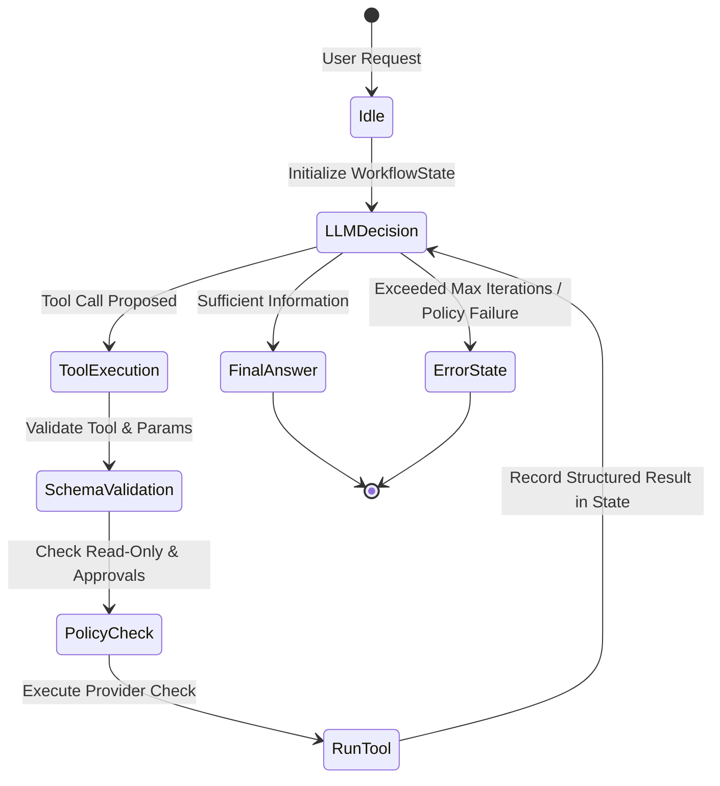
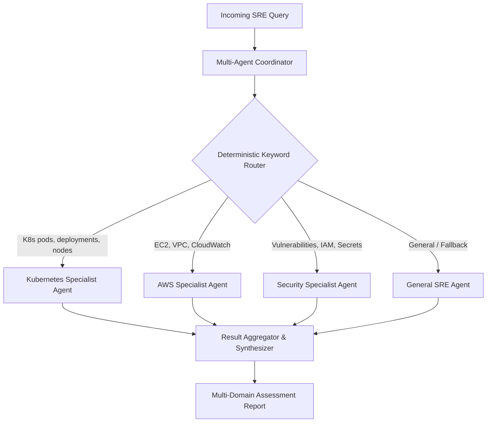
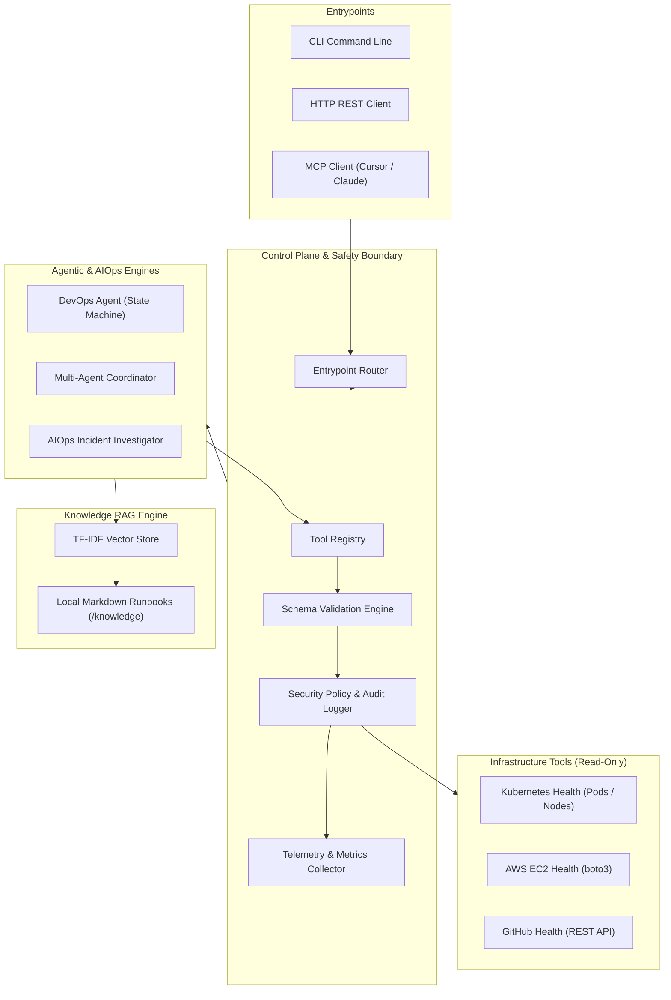
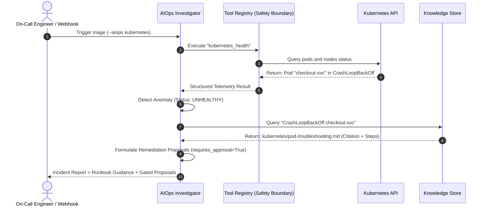

# DevOps Health Checker: Master Architectural & Production Documentation

---

## Table of Contents
1. [Executive Summary](#1-executive-summary)
2. [Industry Problem & Production Value](#2-industry-problem--production-value)
3. [Core Architectural Concepts & Technologies](#3-core-architectural-concepts--technologies)
   - [3.1 Technology Stack](#31-technology-stack)
   - [3.2 The Agentic State Machine & Workflow Engine](#32-the-agentic-state-machine--workflow-engine)
   - [3.3 Multi-Agent Specialist Coordination](#33-multi-agent-specialist-coordination)
   - [3.4 Retrieval-Augmented Generation (RAG) Architecture](#34-retrieval-augmented-generation-rag-architecture)
   - [3.5 Security, Safety Boundaries & Governance](#35-security-safety-boundaries--governance)
   - [3.6 Model Context Protocol (MCP) Integration](#36-model-context-protocol-mcp-integration)
   - [3.7 Observability & Telemetry](#37-observability--telemetry)
   - [3.8 Cloud-Native Kubernetes Architecture](#38-cloud-native-kubernetes-architecture)
   - [3.9 CI/CD & Cryptographic Supply Chain Security](#39-cicd--cryptographic-supply-chain-security)
4. [System Architecture & Data Flows](#4-system-architecture--data-flows)
   - [4.1 Global High-Level Architecture](#41-global-high-level-architecture)
   - [4.2 Incident Triage & AIOps Flow](#42-incident-triage--aiops-flow)
   - [4.3 Knowledge Ingestion & Retrieval Pipeline](#43-knowledge-ingestion--retrieval-pipeline)
5. [Step-by-Step Operations & Usage Manual](#5-step-by-step-operations--usage-manual)
   - [5.1 Local Setup & Verification](#51-local-setup--verification)
   - [5.2 CLI Commands Reference](#52-cli-commands-reference)
   - [5.3 Running the HTTP REST API](#53-running-the-http-rest-api)
   - [5.4 Using as an MCP Server in Cursor/Claude/Antigravity](#54-using-as-an-mcp-server-in-cursorclaudeantigravity)
   - [5.5 Deploying to Kubernetes (Production Manifests)](#55-deploying-to-kubernetes-production-manifests)
6. [Real-World Production Scenarios & Walkthroughs](#6-real-world-production-scenarios--walkthroughs)
7. [Production Readiness, Security Gaps & Future Roadmap](#7-production-readiness-security-gaps--future-roadmap)

---

## 1. Executive Summary

**DevOps Health Checker** is an enterprise-grade, read-only **Agentic AIOps & SRE Assistant**.

It automates the operational triage of modern cloud infrastructure (AWS, Kubernetes, GitHub) and correlates live telemetry with an internal runbook knowledge base using **Retrieval-Augmented Generation (RAG)**.

### Key Value Propositions:
- **Zero-Trust Safety by Design**: Every tool is strictly **read-only**. The AI model cannot execute shell commands, wipe databases, modify Kubernetes resources, or restart servers without explicit human-in-the-loop authorization.
- **Offline & Cost-Resilient**: The core knowledge retrieval engine (RAG) utilizes a deterministic, dependency-free **TF-IDF vector space model** with Kubernetes term normalization. It functions with zero external vector database dependencies, zero API costs, and full offline air-gapped capability.
- **Multi-Modal Interfaces**: The application can be consumed via **CLI**, as a containerized **REST API**, as an **autonomous multi-agent coordinator**, or as an **MCP (Model Context Protocol)** server integrated into developer IDEs.
- **Hardened Cloud-Native Packaging**: Ships with production-ready Docker containers (non-root, read-only rootfs) and complete Kubernetes Day-2 manifests (HPA, PDB, Ingress, NetworkPolicies), validated through a hardened CI/CD pipeline featuring **Trivy vulnerability scanning** and **Cosign keyless cryptographic signing**.

---

## 2. Industry Problem & Production Value

### 2.1 The Modern SRE & DevOps Crisis
In modern distributed cloud environments, Site Reliability Engineers (SREs) and DevOps teams face severe challenges during system incidents:

1. **Context Fragmentation & Cognitive Overload**:
   During a high-severity incident (e.g., SEV-1 outage), an on-call engineer must simultaneously navigate:
   - AWS Console (EC2 instances, CloudWatch metrics, ALB health)
   - Kubernetes clusters (`kubectl get pods`, `kubectl describe`, events, node memory pressure)
   - GitHub repositories (recent pull requests, broken CI/CD pipelines, release tags)
   - Documentation systems (Confluence, Notion, Markdown runbooks in git)
   
   Correlating these fragmented sources consumes 70-80% of total incident time.

2. **Runbook Drift & Forgotten Knowledge**:
   Engineering organizations spend hundreds of hours writing post-mortems and runbooks. However, during live outages, engineers rarely search or read documentation due to panic or poor searchability.

3. **The Danger of Uncontrolled AI Automation**:
   Deploying raw LLM agents with write permissions directly to production clusters introduces severe risks of catastrophic outages due to model hallucinations, incorrect parameters, or prompt injections.

### 2.2 How DevOps Health Checker Solves This
| Challenge | DevOps Health Checker Solution |
| :--- | :--- |
| **High Mean Time to Detect/Diagnose (MTTD)** | Probes AWS, K8s, and GitHub in parallel via a unified execution engine in **< 2 seconds**. |
| **Scattered Runbooks** | Ingests internal Markdown runbooks, normalizes cloud terms, and matches them to active symptoms with source citations. |
| **Unsafe Remediation Risks** | Separates **investigation** from **execution**. All diagnostic operations are read-only; all remediation recommendations enforce `requires_approval: true`. |
| **Audit & Compliance Requirements** | Logs all tool invocations with UTC timestamps, tool names, and parameter names while **strictly scrubbing values and credentials** to prevent data leaks. |

---

## 3. Core Architectural Concepts & Technologies

### 3.1 Technology Stack
- **Language**: Python 3.12+ (Utilizing modern type annotations, match-case, and dataclasses).
- **Package & Environment Management**: `uv` (Next-generation, ultra-fast Python package manager).
- **Cloud & Infrastructure SDKs**:
  - `boto3` for AWS EC2 & CloudWatch integration.
  - `kubernetes` client for cluster, node, and pod health checks.
  - `httpx` & GitHub REST API for repository and CI/CD status inspection.
- **Web & API Framework**: `FastAPI` & `Uvicorn` for high-throughput, asynchronous REST endpoints with Bearer token authentication.
- **Protocol Standards**: **Model Context Protocol (MCP)** using JSON-RPC 2.0 over standard I/O (stdio).
- **Testing & Quality**: `pytest`, `pytest-cov`, `ruff` (linter and formatter), `mypy` (strict type checking), and `bandit` (SAST security scanning).
- **Containerization & Deployment**: Multi-stage `Dockerfile`, Helm/Kubernetes manifests (Deployment, Service, HPA, PDB, Ingress, NetworkPolicy).
- **Supply Chain Security**: GitHub Actions, Aqua Security `Trivy` (container scanning), Sigstore `Cosign` (cryptographic keyless OIDC attestation).

---

### 3.2 The Agentic State Machine & Workflow Engine
Instead of relying on fragile, monolithic prompt chains, the agent runs on `DevOpsWorkflow`, a graph-style state orchestrator inspired by **LangGraph**:



- **`WorkflowState`**: An immutable-style state tracker that records the route history, current iteration, collected tool outputs, encountered errors, and final synthesized answer.
- **Controlled Iteration Limit**: The state machine strictly limits agent reasoning cycles (default: 5 iterations) to eliminate infinite loops and runaway API token consumption.
- **Structured Failure Preservation**: If a tool fails (e.g. AWS credential expiration), the failure is preserved as a structured dictionary. The agent receives this as evidence of an unreachable provider rather than assuming the infrastructure is healthy.

---

### 3.3 Multi-Agent Specialist Coordination
The system implements a **Coordinator-Worker Multi-Agent Architecture** (`MultiAgentCoordinator`):



- **Selective Routing**: Capped at a maximum of **two relevant specialists** per query to prevent noisy, expensive fan-outs.
- **Failure Isolation**: If one specialist encounters a timeout or credential issue, other specialists continue unaffected. The coordinator merges partial evidence gracefully.

---

### 3.4 Retrieval-Augmented Generation (RAG) Architecture
The knowledge retrieval system (`src/devops_health_checker/rag/`) connects documentation to operational realities:

```
[Markdown Runbooks] ──► [Document Loader] ──► [Chunker (Sliding Window)] ──► [Domain Normalizer] ──► [TF-IDF Index]
                                                                                                          │
                                    User Query ("pod crash loop") ────────────────────────────────────────┘
                                                                                                          ▼
                                                                                           [Cosine Similarity Search]
                                                                                                          ▼
                                                                                              [Ranked CITED Results]
```

#### Why a Dependency-Free TF-IDF Baseline?
1. **Air-Gapped & Offline Ready**: Runs in isolated enterprise environments without outbound internet access.
2. **Zero Ingestion Cost**: Eliminates embedding API fees and vector database cluster costs (Pinecone, Weaviate, etc.).
3. **Domain Normalization**: Lexical search often fails on DevOps acronyms. The engine features a domain-specific normalization layer:
   - `crash loop` / `crash looping` $\rightarrow$ `CrashLoopBackOff`
   - `out of memory` / `oom` $\rightarrow$ `OOMKilled`
   - `image pull error` $\rightarrow$ `ImagePullBackOff` / `ErrImagePull`
4. **Precision and Recall Evaluation**: Built-in test fixtures (`RetrievalCase`, `evaluate_retrieval`) measure $Precision@K$, $Recall$, and $Hit\ Rate$ deterministically in automated CI runs.

---

### 3.5 Security, Safety Boundaries & Governance
The tool registry (`ToolRegistry`) acts as an immutable **Security Boundary**:

1. **Strict Read-Only Enforcement**:
   Every registered tool has metadata flags: `read_only: bool` and `requires_approval: bool`. Tools requiring approval cannot be invoked by LLM decision alone; approval must be explicitly passed by the host system.
2. **Input Validation**:
   Parameter types, required keys, and unexpected argument injection are validated against schemas before reaching tool functions.
3. **Audit Logging Without Data Leaks**:
   Every execution logs:
   - UTC Timestamp
   - Tool Name
   - Execution Status (`SUCCESS` / `FAILED` / `DENIED`)
   - **Argument Names Only** (All argument values, passwords, and tokens are omitted to prevent leaking secrets into log aggregators).

---

### 3.6 Model Context Protocol (MCP) Integration
**DevOps Health Checker** natively implements the Anthropic **Model Context Protocol (MCP)** specification:
- Exposes `initialize`, `tools/list`, and `tools/call` over JSON-RPC 2.0 via `stdio`.
- Allows developer tools (Claude Desktop, Cursor IDE, Antigravity IDE) to discover and call these DevOps tools directly from their chat window.

---

### 3.7 Observability & Telemetry
The observability system (`MetricsCollector`) tracks operational health:
- **Per-Tool Metrics**: Invocation counts, failure counts, and p95/average execution latencies.
- **LLM Performance**: Request latencies, prompt tokens, completion tokens, and dollar cost tracking.
- **Audit Trails**: In-memory and structured JSON log streams (`logger.py`) formatted for Datadog, Grafana Loki, or AWS CloudWatch.

---

### 3.8 Cloud-Native Kubernetes Architecture
The application is packaged and deployed with Day-2 production manifests located in [`deploy/kubernetes/`](file:///home/parth/Parth/Parth/My-DevOps-Folder/4.%20DevOps%20Projects/agentic-devops-project/devops-health-checker/deploy/kubernetes):

- **Deployment**:
  - 2 replicas across distinct nodes for high availability.
  - Liveness and Readiness probes checking `/health`.
  - Security Context: `readOnlyRootFilesystem: true`, `runAsNonRoot: true`, `runAsUser: 10001`, `allowPrivilegeEscalation: false`, `capabilities: drop: ["ALL"]`.
- **Horizontal Pod Autoscaler (HPA)**: Automatically scales between 2 and 5 replicas based on CPU (70%) and Memory (80%) thresholds.
- **Pod Disruption Budget (PDB)**: Enforces `minAvailable: 1` during node draining and rolling upgrades.
- **NetworkPolicy**: Strict ingress control allowing traffic only on port 8000 from within the ingress controller namespace.

---

### 3.9 CI/CD & Cryptographic Supply Chain Security
The repository is governed by two automated GitHub Actions pipelines:

1. **Continuous Integration ([`.github/workflows/ci.yml`](file:///home/parth/Parth/Parth/My-DevOps-Folder/4.%20DevOps%20Projects/agentic-devops-project/devops-health-checker/.github/workflows/ci.yml))**:
   - **Linting & Formatting**: `ruff check` and `ruff format --check`.
   - **Type Verification**: `mypy --strict`.
   - **SAST Security Scan**: `bandit` security analysis.
   - **Unit & Integration Tests**: `pytest` covering all 121 test suites across Python 3.12.
2. **Release & Supply Chain Pipeline ([`.github/workflows/release.yml`](file:///home/parth/Parth/Parth/My-DevOps-Folder/4.%20DevOps%20Projects/agentic-devops-project/devops-health-checker/.github/workflows/release.yml))**:
   - Triggers on semantic version tags (`v*.*.*`).
   - Builds multi-platform container images via Docker Buildx.
   - **Vulnerability Scanning**: Aqua Security `Trivy` scans the image for CVEs and halts on `CRITICAL` unfixed vulnerabilities.
   - **Keyless Image Signing**: Sigstore `Cosign` cryptographically signs the container digest using GitHub OIDC identity.
   - Publishes verified images to **GitHub Container Registry (GHCR)**.

---

## 4. System Architecture & Data Flows

### 4.1 Global High-Level Architecture



---

### 4.2 Incident Triage & AIOps Flow



---

## 5. Step-by-Step Operations & Usage Manual

### 5.1 Local Setup & Verification
Ensure you have `uv` installed on Linux/macOS:
```bash
# Clone the repository
git clone https://github.com/GhlParth/devops-health-checker.git
cd devops-health-checker

# Sync virtualenv and dependencies
uv sync --frozen

# Run full test suite to verify health
uv run pytest
```

---

### 5.2 CLI Commands Reference

| Command | Purpose | Example |
| :--- | :--- | :--- |
| `--list-tools` | View all registered tools and safety flags | `uv run devops-health-checker --list-tools` |
| `--knowledge <query>` | Search local runbooks via RAG | `uv run devops-health-checker --knowledge "pod crash loop"` |
| `--aiops <components>` | Run autonomous triage on target systems | `uv run devops-health-checker --aiops kubernetes,aws` |
| `--kubernetes` | Execute standalone Kubernetes cluster check | `uv run devops-health-checker --kubernetes` |
| `--aws` | Execute standalone AWS EC2/CloudWatch check | `uv run devops-health-checker --aws` |
| `--github` | Check GitHub repository health and workflows | `uv run devops-health-checker --github` |
| `--all` | Run all provider checks in parallel | `uv run devops-health-checker --all` |
| `--multi-agent <query>` | Route question to specialist agents | `uv run devops-health-checker --multi-agent "Assess pod crash risks"` |
| `--agent <question>` | Ask the conversational agent (requires LLM) | `uv run devops-health-checker --agent "Why is my pod crashing?"` |

---

### 5.3 Running the HTTP REST API
Start the server:
```bash
DEVOPS_API_TOKEN=supersecret123 uv run devops-health-checker --api-server
```

Interact with the API:
```bash
# 1. Health check (No auth needed)
curl http://localhost:8000/health

# 2. List tools (Bearer auth required)
curl -H "Authorization: Bearer supersecret123" http://localhost:8000/tools

# 3. Query Runbooks
curl -H "Authorization: Bearer supersecret123" \
  "http://localhost:8000/knowledge?query=CrashLoopBackOff"
```

---

### 5.4 Using as an MCP Server in Cursor/Claude/Antigravity
The system can run as an MCP server via `stdio`:
```bash
uv run devops-health-checker --mcp-server
```

To configure in **Cursor** or **Claude Desktop**, add this to your `claude_desktop_config.json` or `cursor.json`:
```json
{
  "mcpServers": {
    "devops-health-checker": {
      "command": "uv",
      "args": [
        "--directory",
        "/absolute/path/to/devops-health-checker",
        "run",
        "devops-health-checker",
        "--mcp-server"
      ]
    }
  }
}
```

---

### 5.5 Deploying to Kubernetes (Production Manifests)
All manifests are pre-configured in [`deploy/kubernetes/`](file:///home/parth/Parth/Parth/My-DevOps-Folder/4.%20DevOps%20Projects/agentic-devops-project/devops-health-checker/deploy/kubernetes):

```bash
# 1. Create your API token secret in the cluster
kubectl create secret generic devops-health-checker-secret \
  --from-literal=DEVOPS_API_TOKEN="production-token-value"

# 2. Apply all Kubernetes resources
kubectl apply -f deploy/kubernetes/deployment.yaml
kubectl apply -f deploy/kubernetes/service.yaml
kubectl apply -f deploy/kubernetes/ingress.yaml
kubectl apply -f deploy/kubernetes/hpa.yaml
kubectl apply -f deploy/kubernetes/pdb.yaml
kubectl apply -f deploy/kubernetes/networkpolicy.yaml

# 3. Verify pod security and scaling status
kubectl get pods -l app=devops-health-checker
kubectl get hpa devops-health-checker-hpa
```

---

## 6. Real-World Production Scenarios & Walkthroughs

### Scenario: E-Commerce Checkout Outage
- **Event**: During a flash sale, the checkout service degrades. PagerDuty notifies the on-call engineer.
- **Execution**: The engineer runs:
  ```bash
  uv run devops-health-checker --aiops kubernetes
  ```
- **What Happens**:
  1. The agent discovers that pod `checkout-service-594df` has restarted 14 times with reason `OOMKilled`.
  2. The RAG engine scans [`knowledge/kubernetes/pod-troubleshooting.md`](file:///home/parth/Parth/Parth/My-DevOps-Folder/4.%20DevOps%20Projects/agentic-devops-project/devops-health-checker/knowledge) and locates the memory triage checklist.
  3. The agent formats an instant incident summary:
     ```json
     {
       "incidents": [
         {
           "component": "kubernetes",
           "status": "CRITICAL",
           "details": "Pod checkout-service-594df restarted 14 times: OOMKilled"
         }
       ],
       "guidance": [
         {
           "source": "kubernetes/pod-troubleshooting.md",
           "content": "OOMKilled indicates that a container exceeded memory limits. Check: kubectl describe pod... investigate JVM heap and memory leaks before increasing limits."
         }
       ],
       "proposals": [
         {
           "action": "increase_memory_limit",
           "requires_approval": true,
           "executed": false
         }
       ]
     }
     ```
- **Result**: The engineer identifies the exact issue, avoids blindly increasing memory without checking JVM logs, and resolves the issue in under 3 minutes.

---

## 7. Production Readiness, Security Gaps & Future Roadmap

| Capability | Current Status | Production Readiness Assessment | Next Architectural Enhancement |
| :--- | :--- | :--- | :--- |
| **Tool Execution** | Read-Only | **Production Ready**: Zero risk of unintended cloud mutations. | Add audited Slack/Jira approval webhooks for write actions. |
| **Knowledge RAG** | Offline TF-IDF | **Production Ready** for dozens of runbooks. Fast, $0 cost, offline. | Add a hybrid vector store (BGE-Small / ChromaDB) for semantic search. |
| **Orchestration** | State Machine | **Production Ready**: Strict iteration caps, failure preservation. | LangGraph / Temporal integration for multi-day workflow tracking. |
| **Container & CI/CD** | Hardened | **Production Ready**: Non-root, Trivy scanned, Cosign signed. | Automated canary deployments via ArgoCD or Flux. |
| **Observability** | Structured Logs | **Production Ready**: In-memory metrics & JSON output. | Export OpenTelemetry traces and Prometheus `/metrics` endpoint. |

---
*Authored for the DevOps & Platform Engineering Team — DevOps Health Checker Architecture.*
